Course paper and presentation for DS 7330, File Organization and Database Management, Fall 2026. Master of Science in Data Science, Southern Methodist University.

[](point-warehouse.pdf)
[](point-warehouse.pptx)

## Presentation

Select a slide to enlarge it. [Download the PowerPoint](point-warehouse.pptx).

```{=html}
<a href="slides/slide-01.png" class="lightbox" data-gallery="point-slides">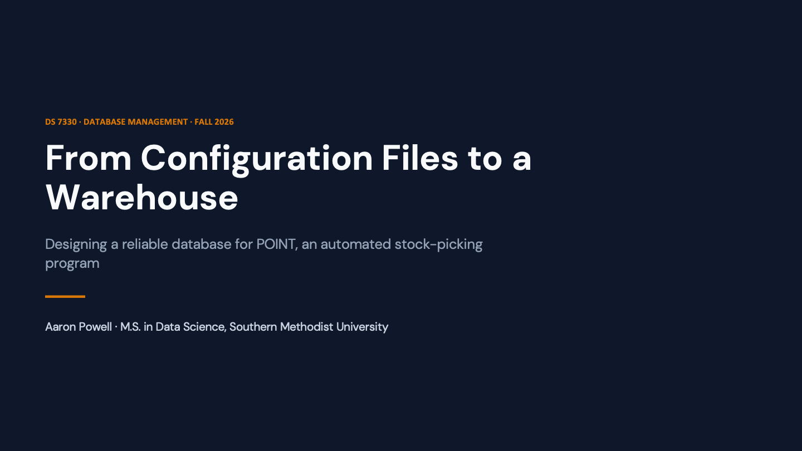</a>
<a href="slides/slide-02.png" class="lightbox" data-gallery="point-slides">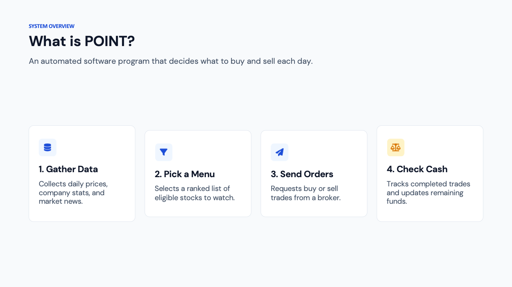</a>
<a href="slides/slide-03.png" class="lightbox" data-gallery="point-slides">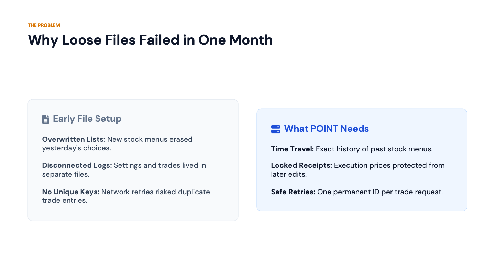</a>
<a href="slides/slide-04.png" class="lightbox" data-gallery="point-slides">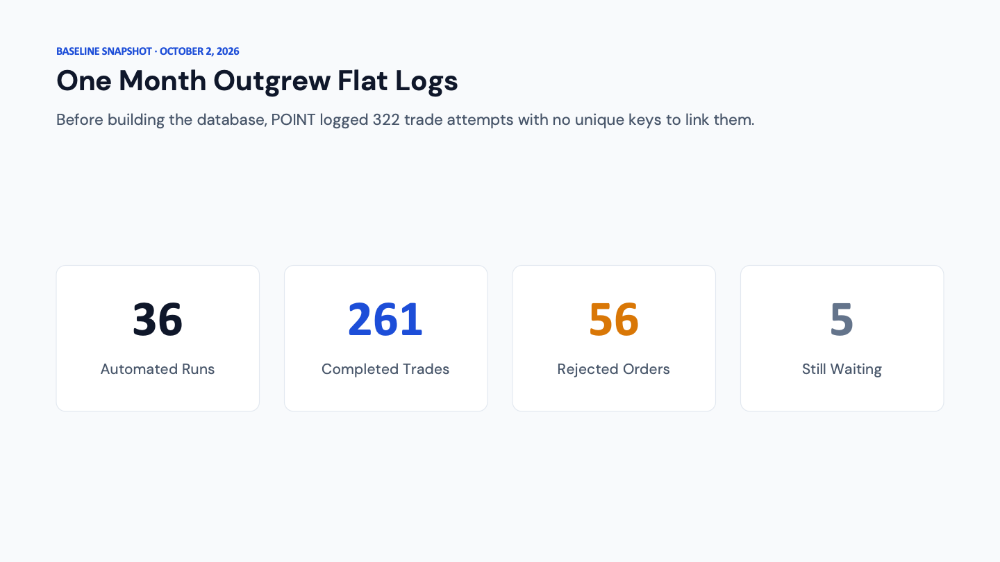</a>
<a href="slides/slide-05.png" class="lightbox" data-gallery="point-slides">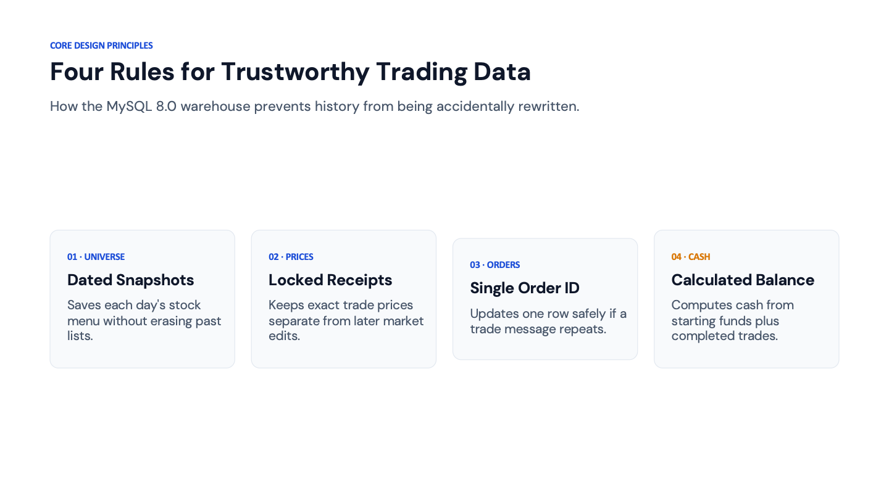</a>
<a href="slides/slide-06.png" class="lightbox" data-gallery="point-slides">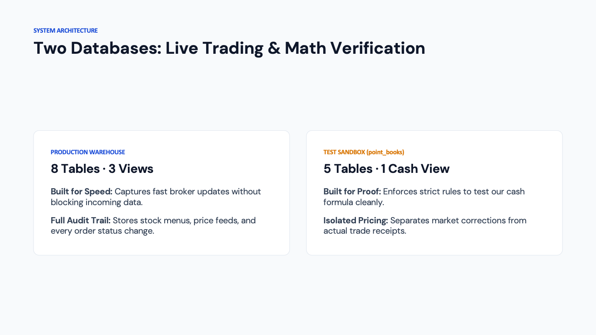</a>
<a href="slides/slide-07.png" class="lightbox" data-gallery="point-slides">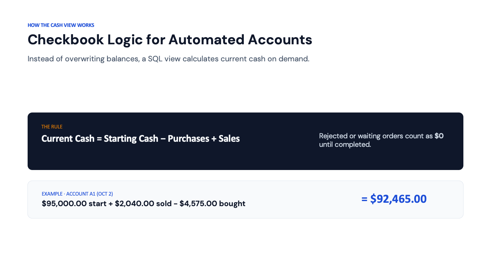</a>
<a href="slides/slide-08.png" class="lightbox" data-gallery="point-slides">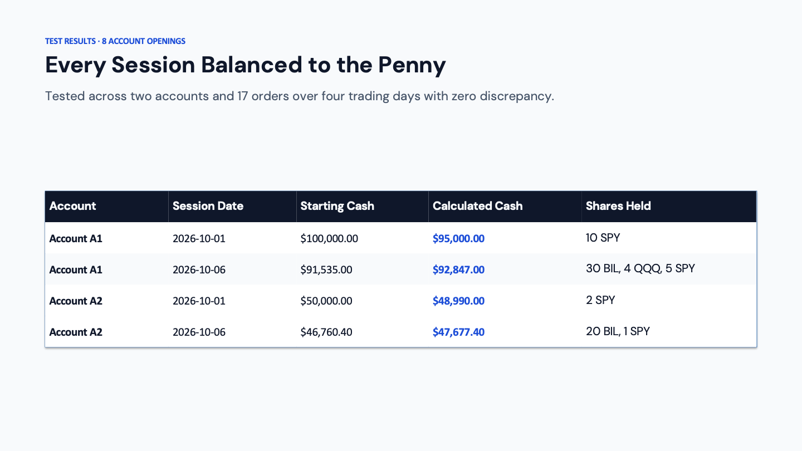</a>
<a href="slides/slide-09.png" class="lightbox" data-gallery="point-slides">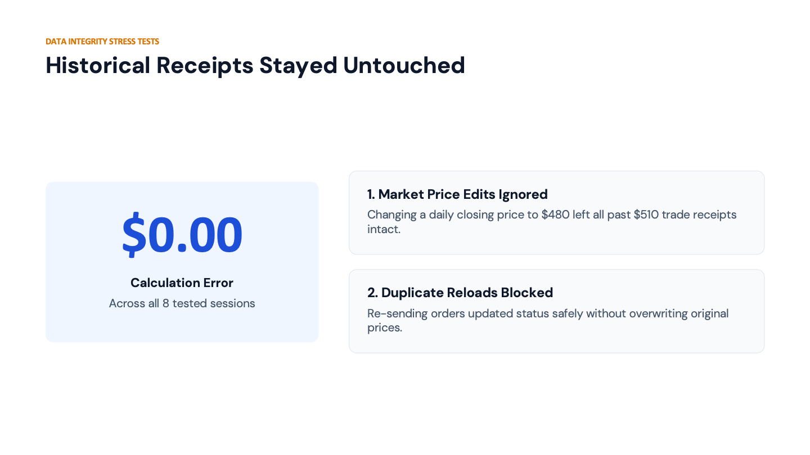</a>
<a href="slides/slide-10.png" class="lightbox" data-gallery="point-slides">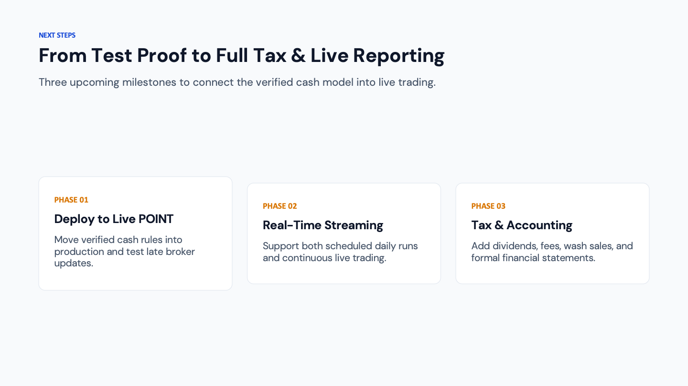</a>
<a href="slides/slide-11.png" class="lightbox" data-gallery="point-slides">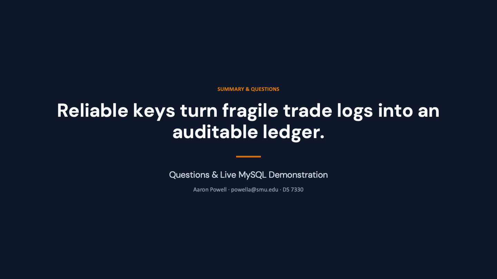</a>
```

## Full Text

```{=html}
<iframe src="point-warehouse.pdf" title="From Configuration Files to a Warehouse" width="100%" height="900" style="border:1px solid #dee2e6;"></iframe>
```

[Download the PDF](point-warehouse.pdf).

## Citation

[@powell2026point]
